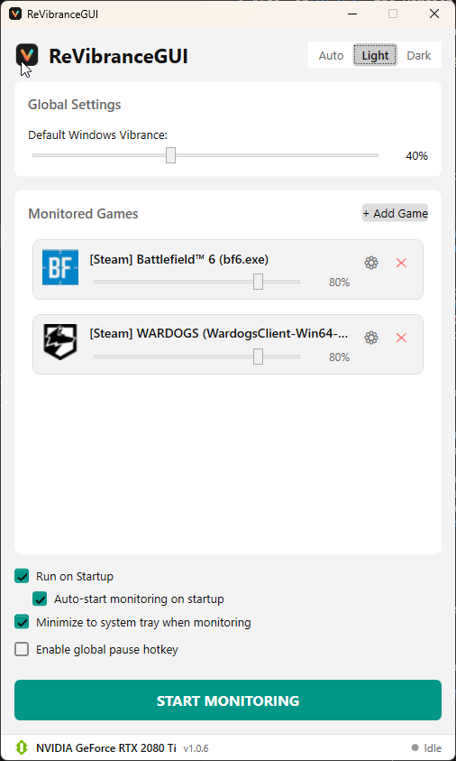
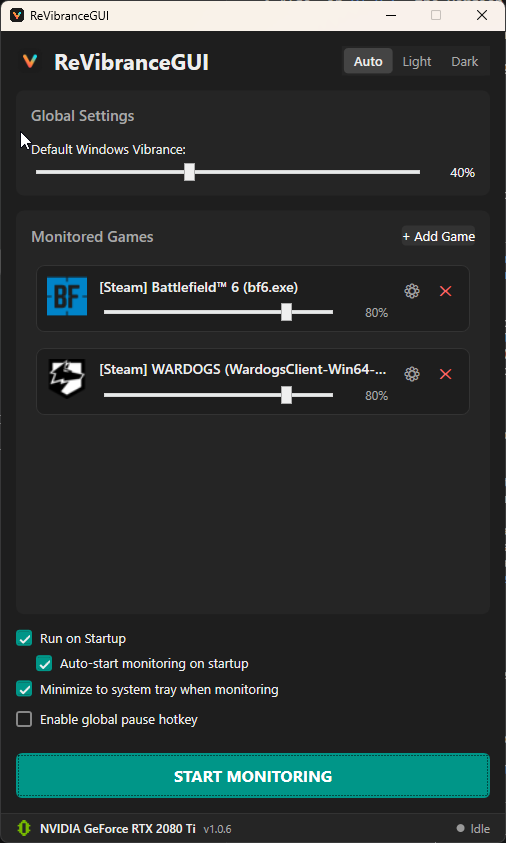

#  ReVibranceGUI

[](https://github.com/roscocheeta/re-vibrance-gui/actions/workflows/ci.yml)
[](https://github.com/roscocheeta/re-vibrance-gui/actions/workflows/codeql.yml)
[](https://github.com/roscocheeta/re-vibrance-gui/releases)


ReVibranceGUI is a lightweight, modern Windows desktop utility that automates NVIDIA, AMD, and Intel GPU vibrance (digital saturation) settings based on the currently active application.

This project is a complete C# WPF / .NET 8 architectural rewrite of the original [vibranceGUI](https://github.com/juvander/vibranceGUI) tool (and draws inspiration from [SteffenCarlsen's fork](https://github.com/SteffenCarlsen/vibranceGUI)), replacing legacy Windows Forms components with modern APIs, robust background polling, and intelligent game-detection heuristics.

> [!WARNING]
> **Experimental Hardware Support:** While ReVibranceGUI natively supports NVIDIA, AMD, and Intel GPUs, it has currently only been actively tested on NVIDIA hardware. AMD and Intel integrations are experimental and may not work exactly as intended. Bug reports are welcome!

<div align="center">
  
  &nbsp; &nbsp;
  
</div>

---

## ✨ Features

- **Per-Process Customization:** Configure specific vibrance levels (50% - 100%) for individual games.
- **Per-Process Display Resolution Switching:** Automatically switch refresh rate and resolution (e.g., 1280x960 144Hz for CS2) when a target game launches, reverting to native resolution on exit.
- **Smart Game Detection:** Automatically scans Steam, Epic Games, GOG, and Blizzard Battle.net manifests to locate game executables effortlessly.
- **Active Process Indicator:** Minimal visual status dot directly on game cards indicating when that specific process is actively running and hooked.
- **Dynamic Icons:** Extracts and mounts native `.exe` icons into Game Cards for a clean visual experience.
- **Multi-GPU Support:** Supports NVIDIA (via NVAPI), AMD (via ADL), and Intel (via IGCL) graphics cards natively.
- **Hardware Integration:** Directly queries and displays your detected graphics adapter and driver status.
- **Non-Intrusive System Tray:** Minimizes silently to the Windows System Tray and runs securely on Windows Startup without UAC prompts.
- **Silent Boot:** Launch completely invisible in the background on Windows startup when configured to minimize to tray.
- **Auto-Start Monitoring:** Automatically begin monitoring games when ReVibranceGUI launches.
- **System Tray Controls:** Right-click the system tray icon to pause, resume, or exit the application.
- **Global Pause Hotkey:** Easily pause and resume vibrance adjustments using a custom global keyboard shortcut.
- **Auto-Update Notifications:** Automatically notifies you when a new version of ReVibranceGUI is available.

---

## 🚀 Architecture & Security Improvements (vs Original)

1. **Removed `SetWinEventHook`:** Replaced legacy global Windows hooks with a lightweight 500ms `Task.Delay` background poller using `GetForegroundWindow`. This improves stability and prevents flags from kernel-level anti-cheat engines that inspect global hooks.
2. **Modern Atomic State Persistence:** Replaced fragile XML/registry storage with an atomic `%AppData%\ReVibranceGUI\settings.json` serializer (writes to a `.tmp` file before replacing to eliminate write corruption).
3. **Multi-Layer Security Pipeline:**
   - **Compile-Time SAST:** `SecurityCodeScan` and `WpfAnalyzers` guard against path traversal, unquoted run paths (CWE-428), unsafe process launching, and XAML binding regressions.
   - **URL Scheme Whitelisting:** All shell navigations explicitly enforce `https://` / `http://` protocols to prevent arbitrary URI execution.
   - **Automated Secret Scanning:** Continuous Integration executes Gitleaks on every commit to ensure zero tokens or secrets enter the repository.
   - **Semantic CodeQL Analysis:** Analyzes data flows to guarantee untrusted inputs cannot reach process execution or file writes without sanitization.
4. **Unified Math Engine:** NVIDIA, AMD, and Intel APIs scale vibrance differently. The core `VibranceMath` engine normalizes them into a unified, predictable `0%` to `100%` scale for the UI.
5. **Multi-Monitor Awareness:** Target vibrance changes strictly to your *Primary* monitor, or broadcast them across *All* connected monitors.

---

## 🚀 Usage Requirements

To run ReVibranceGUI, you will need:
- **OS:** Windows 10 or Windows 11
- **Runtime:** [.NET 8.0 Desktop Runtime (v8.0.x)](https://dotnet.microsoft.com/en-us/download/dotnet/8.0) 

Download the latest `ReVibranceGUI.exe` from the [Releases](https://github.com/roscocheeta/re-vibrance-gui/releases) page and run it.

---

## 🛠️ Development & Building

### Build Requirements
- **OS:** Windows 10/11
- **Framework:** .NET 8 SDK (`net8.0-windows`)

### Compiling
To build the project locally, run:
```bash
dotnet build ReVibranceGUI.sln --configuration Release
```
The executable will be located in `ReVibranceGUI/bin/Release/net8.0-windows/`.

### Testing & Verification
We use `xUnit` with OS boundary contract testing and in-memory seams. For a detailed breakdown of what is covered, see our [Testing Guide](TESTING.md).

```bash
# Run unit & contract tests
dotnet test ReVibranceGUI.sln --configuration Release

# Check for dependency vulnerabilities
dotnet list package --vulnerable --include-transitive
```

---

## 🗺️ Roadmap

The core Phase 1 modernization features are complete (see [Enhancements Archive](docs/enhancements.md)). Active future items include:

- [ ] **Community Hardware Testing:** Extended testing and feedback collection across AMD Radeon (RDNA 2/3) and Intel Arc graphics adapters.
- [ ] **Additional Launchers:** Manifest scanners for EA App, Ubisoft Connect, and Xbox / Microsoft Store installations.
- [ ] **Profile Sharing:** Export and import game profiles as portable `.json` files.
- [ ] **Visual Regression UI Tests:** Automated WPF layout and clipping tests using snapshot verification.

---

## 🤝 Contributing

Contributions are welcome! Please read our [Contributing Guide](CONTRIBUTING.md) and [AI Agent Instructions](AGENTS.md) before submitting a Pull Request.

---

## 📜 License
This project is a complete rewrite of the original `vibranceGUI` by [juvander](https://github.com/juvander) and [SteffenCarlsen](https://github.com/SteffenCarlsen). Please note that the original upstream repositories do not contain an explicit open-source license. This rewrite is provided for educational and personal use.
